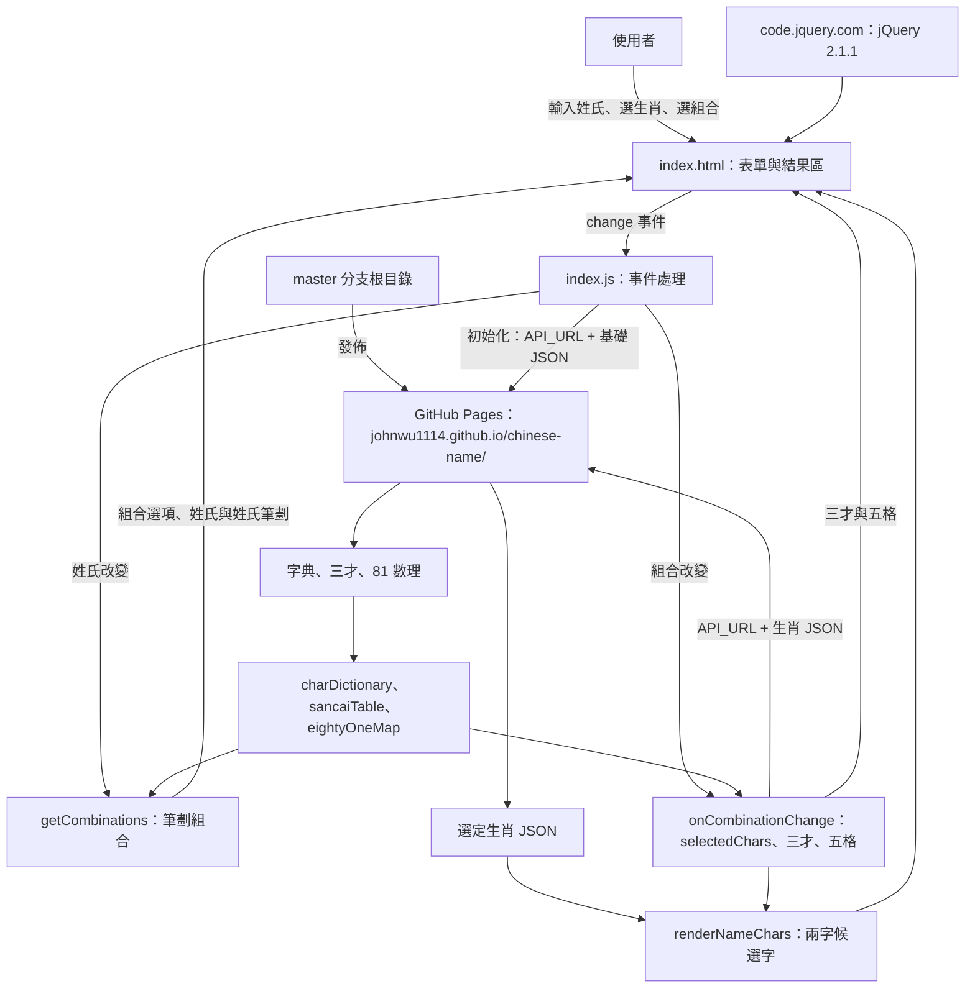

# 現況架構

## 1. 定位與啟動

chinese-name 是新生兒中文取名的純前端靜態網頁。使用者輸入單字姓氏、選擇生肖與筆劃組合，再查看候選字、三才及五格結果。它參考周易文字筆劃五行、十二生肖姓名學、81 數理姓名學及五行三才姓名學。

repo 沒有後端服務或建置步驟。可用瀏覽器開啟 `index.html`，或用 Python 靜態伺服器預覽。頁面仍須成功載入 jQuery 與遠端 JSON。人工預覽步驟見[工作流程](workflow.md#22-人工預覽步驟)。

## 2. 目錄與模組職責

| 路徑 | 職責 |
| ---- | ---- |
| `index.html` | 單頁表單與結果區。包含 CSS、生肖選項及畫面文字。載入 jQuery 2.1.1 CDN 與 `index.js`。 |
| `index.js` | 全部應用邏輯。包含常數、核心演算法、UI 渲染、事件處理及初始化。 |
| 根目錄 JSON | 字典、三才、81 數理與各生肖資料的本地版本。執行時使用的來源見第 3 節。 |
| `docs/` | 現況文件、索引與重要決策索引。 |
| `docs/archive/` | 已完成的計畫與需求，只供追溯。一般任務不讀封存正文。 |

| 函式 | 目前責任 |
| ---- | ---- |
| `getCombinations(familyName)` | 由姓氏字典筆劃、三才與 81 數理計算合格筆劃組合。找到姓氏時，也把姓氏、姓氏字形五行色標與姓氏筆劃寫入 `.familyName`、`.familyNameDrawCount`。 |
| `get5EColor(fiveEle)` | 將五行文字或尾數轉成五行色標 HTML。 |
| `getWordsOf5E(chars)` | 只保留出現在 `selectedChars` 的字，加上字形五行色標，再以「, 」串接。不在 `selectedChars` 的字不顯示。 |
| `renderResult(type, draw)` | 顯示指定五格的筆劃、五行、81 數理評語及描述。 |
| `renderNameChars(index, draw, zodiacData)` | 共用第一字與第二字的候選字渲染。分為喜用、忌用與不喜不忌。 |
| `onFamilyNameChange()` | 重設組合選單，產生組合選項，依分數降序、中字及下字筆劃升序排列。 |
| `onCombinationChange()` | 以中字與下字筆劃建立 `selectedChars`，更新三才與五格，再請求選定生肖資料並渲染兩字候選字。 |
| `onZodiacChange()` | 觸發姓氏的 change 事件，重新計算並重設組合選單。它不請求生肖資料，畫面上的候選字維持舊生肖的結果，直到使用者重選組合。 |
| `onBtnDisplayClick()` | 切換按鈕所在列（不喜不忌或生肖忌用）的顯示狀態。生肖喜用列固定顯示。 |

初始化綁定事件，並分別請求字典、三才及 81 數理資料。81 數理資料載入後，以 `draw` 建立 `eightyOneMap`。

## 3. 外部關係與資料流

圖說：初始化時，腳本從 `API_URL` 載入三份基礎資料。使用者改變姓氏時，`getCombinations` 產生組合選項。使用者選擇組合時，腳本更新三才與五格，再載入選定生肖資料並渲染候選字。`API_URL` 的內容由 `master` 分支發佈。圖中分組是資料職責，不代表額外服務。

`API_URL` 在程式內固定為 `https://johnwu1114.github.io/chinese-name/`。初始化及生肖查詢都將檔名接在此網址後方，不使用頁面所在目錄作為 JSON 來源。

因此，本機預覽也不讀取本地 JSON。資料修改要 push 到 `master`，並由 GitHub Pages 發佈後，才會反映在畫面上。發佈來源與查核日期見[工作流程](workflow.md#3-交付與發佈)。

jQuery 使用通訊協定相對的 CDN URL。直接以檔案開啟頁面時，須另確認 CDN 是否能載入。三份基礎資料各自非同步載入；程式沒有等待全部完成再啟用輸入，也沒有 JSON 請求失敗處理。驗證時須先確認請求成功。

## 4. 資料檔與命名演算法

| 本地檔案 | 資料結構與用途 |
| ---- | ---- |
| `chinese-characters.json` | 陣列。每筆含筆劃數 `draw`、字形五行 `fiveEle`、字元字串 `chars`。 |
| `sancai.json` | 物件。鍵為三元素組合，例如「水木木」。值含分數 `value`、評語 `text`、描述 `content`。 |
| `eighty-one.json` | 陣列。每筆含筆劃 `draw`、分數 `value`、評語 `text`、描述 `content`。 |
| `01-rat.json` 至 `12-pig.json` | 生肖物件。`type` 是生肖文字。`better`、`worse` 以 `_8` 等筆劃鍵對應字元陣列。 |

字典的字形五行與三才的筆劃尾數五行是不同用途。字形五行用於姓氏與候選字的色標；三才及五格計算使用筆劃尾數。

`SANCAI_ELEMENTS` 的索引 0 至 9 依序是水、木、木、火、火、土、土、金、金、水。`getCombinations` 先在字典中查姓氏筆劃，再以姓氏筆劃加一的尾數選天格五行。函式只考慮三才分數至少 8 的組合，並遍歷各為 1 至 26 劃的中字與下字。

設姓氏、中字、下字筆劃為 A、B、C，五格筆劃依序是天格 A+1、人格 A+B、地格 B+C、外格 C+1、總格 A+B+C。將五格的 81 數理分數相加後乘 2，得到綜合分數。程式將 `QUALITY_THRESHOLD` 限制於 0 至 100，再保留達到門檻的組合；預設門檻是 75。

畫面輸入限制姓氏最多一個字。程式未提供複姓流程。字典查無姓氏時，程式不顯示錯誤，改以姓氏筆劃 0、天格五行「水」繼續計算組合；畫面上的姓氏與姓氏筆劃保留前一次的值。本文描述實作行為，不驗證姓名學的有效性。

## 5. 相關正本

修改流程見[工作流程](workflow.md)。命名、資料維護與分區規則見[慣例](conventions.md)。重要決策任務才開啟 [ADR 索引](adr/README.md)，並依閱讀限制查必要的單篇。
