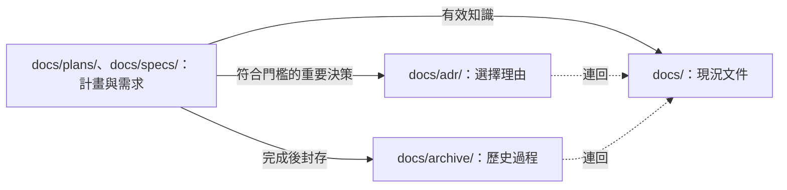

# Repo 慣例

## 1. 命名與程式分區

### 1.1 JSON 檔名

- 所有 JSON 資料檔使用 kebab-case，例如 `chinese-characters.json`、`eighty-one.json`。
- 生肖檔使用兩位數前綴加英文生肖名，依序為 `01-rat.json` 至 `12-pig.json`。
- 改檔名時，同步修改 `index.js` 與 `index.html` 的引用。改完搜尋舊檔名，確認沒有殘留。

### 1.2 `index.js` 分區

`index.js` 由上至下分成五個區塊：常數與設定、核心演算法、UI 渲染、事件處理、初始化。每個區塊以一行註解分隔，格式如下：

```javascript
// ==================== 事件處理 ====================
```

新函式放進對應職責的區塊。名字第一字與第二字共用 `renderNameChars(index, draw, zodiacData)`，以 `index` 為 1 或 2 區分，不另寫重複的渲染邏輯。它寫入的元素以 `index` 組成 class：`.giveNameDrawCount{index}`、`.giveName{index}_better`、`.giveName{index}_worse`、`.giveName{index}_normal`。

### 1.3 識別符與選擇器

函式與狀態名稱使用 camelCase，設定常數使用 UPPER_SNAKE_CASE。保留 `index.html` 的 DOM id／class 與 `index.js` 選擇器的對應。修改選擇器時，一併檢查 HTML 與兩個名字位置。

新增一般文件使用小寫 dash 檔名。`README.md`、`AGENTS.md` 等既定名稱不改。

## 2. 資料與介面

資料欄位與執行時載入方式見[現況架構](architecture.md#4-資料檔與命名演算法)。JSON 可含 UTF-8 BOM；驗證時使用[已實跑的解碼與解析方式](workflow.md#21-json-與文件檢查)。不統一或重寫既有 JSON 排版。

### 2.1 字形五行

`chinese-characters.json` 的 `fiveEle` 依字形五行判定，也就是依部首歸類。部首以字的外部部首（形符）為準：

| 五行 | 部首 |
| ---- | ---- |
| 水 | 氵、冫、水、雨、魚 |
| 火 | 火、灬、日 |
| 土 | 土、山、石、田 |
| 木 | 木、艹、禾、竹、弓、耒 |
| 金 | 金、釒、刂、刀、匕、戈、矛、辛、酉、斤 |

- 部首不在表中的字，保留原本的 `fiveEle` 值。
- 校正 `fiveEle` 時只改這個欄位。不改 `draw`、`fiveEle`、`chars` 的資料結構，也不增刪字；目前字典共 7,032 字。
- 前端只讀取 `fiveEle`，沒有即時判定部首的程式，repo 也沒有批次校正腳本。本表是資料維護規則，不是執行時分類器。

### 2.2 生肖資料

生肖資料結構見[現況架構](architecture.md#4-資料檔與命名演算法)。不喜不忌字由程式從字典扣除喜用與忌用字產生，不另維護第三份生肖字表。

### 2.3 筆劃

字典的 `draw` 與生肖表的 `_<筆劃>` 鍵一律使用康熙筆劃。算法、例外表與簡體殘字的判定見 [ADR 0001](adr/0001-kangxi-stroke-standard.md)。

- 新增或修改字時，依 ADR 0001 的算法計算筆劃；例外表內的字用例外值。
- 字移到新筆劃時保留原 `fiveEle`。字典依 `draw`、`fiveEle` 排序；生肖表的鍵依筆劃數字排序，同一部分不重複列同一字。
- 同一字同一筆劃不可同時出現在同一生肖的喜用與忌用。2026-11-19 校正後，`11-dog.json` 的「和、昕、杭、果、長」在 `_8` 同時出現在兩邊，仍待決定。
- repo 沒有筆劃校正腳本。重算需要 Unihan 15.0（含 `kRSKangXi`）與 UCD 的部首資料。

## 3. 文件寫作與附圖

請 AI「用八成接近 ASD-STE100 的方式寫，並附圖」。使用繁體中文（台灣）、短句、主動語態與一致術語。一句一個重點。操作須寫出執行者、條件、動作與驗證結果，不宣稱符合 ASD-STE100 或具有合規分數。

現況文件回答目前如何運作。spec 記錄尚未落地的需求，plan 記錄一次實作的步驟與進度，ADR 保存重要選擇理由，封存資料保存歷史過程。同一規則只維護一份正文。repo 內使用相對 Markdown 連結，不連本機絕對路徑。



圖說：一次修改完成時，內容依職責分流。實線是內容去向，虛線是歷史紀錄對現況文件的連結。分流規則見[文件更新責任](../AGENTS.md#5-文件更新責任)。

架構圖與流程圖優先放在相關 Markdown 正本的 Mermaid 區塊。節點與箭頭必須有事實依據，附圖說並與正文同步更新。缺少依據時明說，不補裝飾節點。入口與純索引可連到[架構圖](architecture.md#3-外部關係與資料流)與[流程圖](workflow.md#1-修改與審查)。

### 3.1 預覽與匯出

1. 用 VS Code 或文件目標平台開啟 Markdown 正本，使用支援 Mermaid 的預覽。
2. 檢查文字可讀、箭頭方向正確、沒有截斷。無法渲染時，交付明列未驗證，本次尚未執行實際渲染。
3. 需要提供其他平台時，從同一份 Mermaid 原始碼以支援 Mermaid 的編輯器匯出 SVG 或 PNG。保留 Markdown 原始碼，匯出圖註明來源文件與章節，不單獨修改匯出檔。
4. 只有 Mermaid 表達、排版或平台支援受限時，才改用其他格式。保留可編輯來源，例如 `.drawio.svg`。既有圖不全面轉換。
5. 有實際圖檔才建立 `images/` 或主題子目錄，使用相對路徑引用。修改正文時，同步更新圖與匯出結果。

repo 沒有 Mermaid 自動渲染或匯出指令。上述步驟是人工方式，不代表本次已驗證特定預覽工具。

## 4. 同步與驗證

修改後檢查路徑大小寫、連結錨點、圖文一致性與程式位置地圖。驗證步驟見[工作流程](workflow.md#2-驗證)。重要決策任務依 [ADR 索引](adr/README.md)辦理，一般任務不主動讀取歷史正文。
