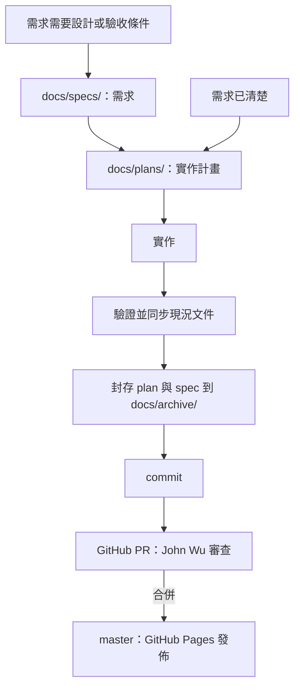

# Repo 工作流程

## 1. 修改與審查

先讀 [AGENTS](../AGENTS.md)、[文件索引](README.md)及受影響現況文件。檢查工作區，保護無關的未提交修改。修改在分支上進行，經 GitHub PR 審查後才合併到 `master`，見第 3 節。

功能修改依以下順序進行：

1. 需求需要設計或驗收條件時，先寫 `docs/specs/<feature>.md`，記錄狀態、範圍、驗收條件與未決事項。需求已清楚時略過。
2. 寫實作計畫 `docs/plans/YYYY-MM-DD-<task>.md`，記錄狀態、步驟、進度、驗收與交付紀錄。
3. 依計畫實作。
4. 依第 2 節驗證，並依第 4 節同步現況文件。
5. 依第 4 節封存完成的 plan 與 spec。
6. commit，並依第 3 節交付。



圖說：功能修改依計畫、實作、驗證、封存、commit 順序完成，再經 GitHub PR 審查後合併到 `master` 上線。需求需要設計時先寫 spec。`docs/specs/`、`docs/plans/` 有內容時才建立。

## 2. 驗證

repo 沒有 build、test 或 lint 指令。以下命令在 repo 根目錄執行，已於 2026-11-19 實跑。

### 2.1 JSON 與文件檢查

部分 JSON 含 UTF-8 BOM，直接用檔案作為 `json.tool` 參數會失敗。以下命令先解碼 BOM，再逐一執行 `python3 -m json.tool`，不改寫資料檔。預期每個檔案輸出 `OK`，本次共 15 份。失敗時先檢查該檔案，不繼續宣稱驗證通過。

```bash
python3 - <<'PY'
from pathlib import Path
import subprocess, sys
for path in sorted(Path('.').glob('*.json')):
    subprocess.run(
        [sys.executable, '-m', 'json.tool'],
        input=path.read_text(encoding='utf-8-sig'),
        text=True, stdout=subprocess.DEVNULL, check=True,
    )
    print(f'{path}: OK')
PY
```

文件變更檢查：

```bash
git diff --check
```

預期無輸出且結束碼為 0。此指令不涵蓋尚未追蹤的新檔案；另檢查新增文件的行尾空白、內部連結與錨點。相對路徑從來源文件所在目錄解析，並確認目標大小寫與程式位置地圖路徑。

### 2.2 人工預覽步驟

本次未啟動靜態伺服器、未連線 localhost，也未執行瀏覽器互動驗證。以下是後續人工檢查步驟。

1. 在 repo 根目錄用 Python 的 `http.server` 模組啟動靜態伺服器，使用連接埠 8000。
2. 在瀏覽器開啟 `http://localhost:8000/`。
3. 在開發者工具確認 jQuery、字典、三才與 81 數理請求成功。資料仍來自 `API_URL` 的遠端網址。
4. 確認生肖預設為「雞」。輸入姓氏「陳」，在「分數」選單選一個組合。確認組合、三才、五格與兩字候選區都有內容。
5. 點不喜不忌列與生肖忌用列的「顯示」，確認該列字詞出現，再點「隱藏」確認收起。
6. 切換生肖，確認「分數」選單重設為「請選擇」。重新選一個組合，確認新生肖資料請求成功且候選字更新。
7. 依[圖示慣例](conventions.md#3-文件寫作與附圖)預覽 Mermaid，確認文字與箭頭可讀且沒有截斷。
8. 結束檢查後停止靜態伺服器。若請求或畫面失敗，記錄失敗項目，不將本地 JSON 的解析通過當成畫面驗證。

## 3. 交付與發佈

驗證及文件整理完成後，commit 本次變更。只包含本次任務檔案，並回報 commit hash。若任務明確禁止 commit，保留工作區變更並回報原因。

GitHub Pages 從 `master` 分支的根目錄發佈（legacy build）。push 到 `master` 就會更新線上頁面，也會更新 `API_URL` 提供的 JSON。資料修改對畫面的影響見[現況架構](architecture.md#3-外部關係與資料流)。發佈設定是 2026-11-19 以 `gh api repos/johnwu1114/chinese-name/pages` 查得的即時資訊；設定改變時同步更新本節。

合併到 `master` 等於上線，因此一律走 GitHub PR：

1. 把分支 push 到 GitHub，開 PR 到 `master`。
2. John Wu 在 PR 上審查 diff，確認第 2 節的驗證結果。
3. 審查通過後，由 John Wu 在 GitHub 合併 PR。GitHub Pages 隨即從 `master` 重新發佈。

上線後發現問題時，在新分支上用 `git revert` 還原問題 commit，同樣開 PR 合併到 `master`。不直接 push 到 `master`，也不改寫 `master` 歷史。

交付需列出變更檔案、驗證結果、未執行檢查與待確認事項。

涉及重要決策時，依 [ADR 索引](adr/README.md)處理，由 John Wu 核准。

## 4. 文件同步與封存

文件同步、ticket／spec／plan 整理與 ADR 處理的責任見 [AGENTS 文件更新責任](../AGENTS.md#5-文件更新責任)。本節只補封存位置。

1. 先把 plan 與 spec 中仍有效的知識併入現況文件。
2. 把完成的 plan 移到 `docs/archive/plans/`，保留原檔名。有寫 spec 時，移到 `docs/archive/specs/`，檔名前加完成日期，例如 `2026-11-19-<feature>.md`。目錄有內容時才建立。
3. 在 [封存索引](archive/README.md) 加一列，寫明完成狀態與對應的現況文件。

封存資料受[歷史閱讀限制](../AGENTS.md#2-必守規則)。
